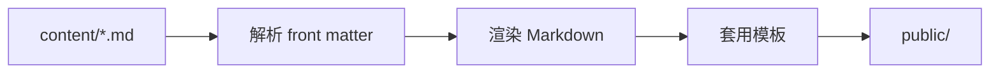

这套博客刻意做得很轻：没有数据库、没有后台、不依赖 Node 生态，只需要一个 Python 就能从 Markdown 生成整站。

## 目录结构

```text
Codex123/
├─ blog.config.json      站点配置：标题、导航、每页文章数…
├─ content/
│  ├─ posts/             文章（Markdown + front matter）
│  └─ pages/             独立页面（关于、友链…）
├─ themes/default/       主题：模板 + 样式 + 脚本
├─ static/               你自己的图片等静态资源
├─ tools/                构建、预览、新建、整理脚本
├─ public/               生成出来的网站（可随时删除重建）
├─ build.ps1 / serve.ps1 / new-post.ps1 / organize.ps1
└─ .venv/                Python 虚拟环境
```

## 构建流程



对，图也能画——不过 Mermaid 需要浏览器插件支持，这里只是用文字示意：

1. 扫描 `content/posts/*.md`，解析文件头的 front matter
2. 用 Python-Markdown 把正文转成 HTML（带代码高亮、目录）
3. 套用 Jinja2 模板，生成文章页
4. 顺手生成首页、分页、归档、标签页、RSS、站点地图和搜索索引

## 一次构建都生成了什么

| 产物 | 说明 |
| --- | --- |
| `index.html`、`page/2.html` | 首页与分页 |
| `posts/*.html` | 每篇文章 |
| `archive.html` | 按年份归档 |
| `tags.html`、`tags/*.html` | 标签总览与单个标签页 |
| `categories/*.html` | 分类页 |
| `feed.xml` | RSS 订阅 |
| `sitemap.xml`、`robots.txt` | 给搜索引擎看的 |
| `search.json` | 站内搜索用的索引 |

## 怎么部署

`public/` 是纯静态文件，随便挑一个就行：

- **GitHub Pages**：推到仓库，把 Pages 指向 `public/`（或用 Actions 每次自动构建）
- **Cloudflare Pages / Netlify / Vercel**：构建命令填 `python tools/build.py`，输出目录填 `public`
- **自己的服务器**：把 `public/` 里的文件传上去就行

部署之前记得先把 `blog.config.json` 里的 `url` 改成真实网址，RSS 和站点地图才能生成正确的链接。